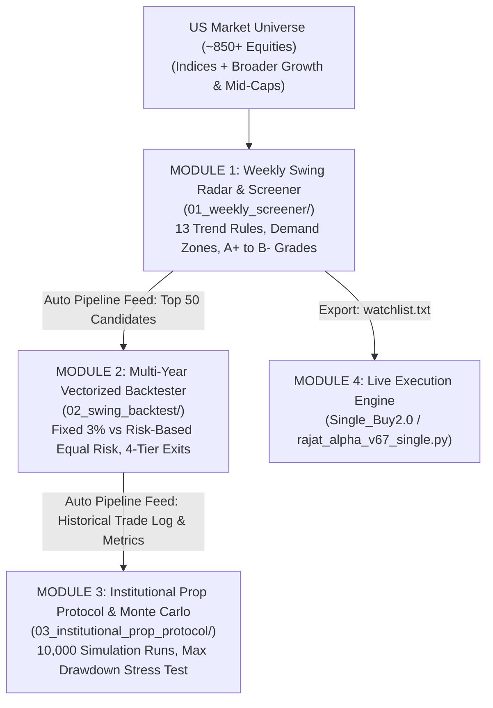

# 🏛️ Google Colab Quantitative Research & Execution Hub (`scripts/colab/`)

This directory contains the complete institutional quantitative research suite, backtesting engines, and market scanner notebooks for the **Rajat Alpha V67 (Version 3.5.1)** trading strategy.

---

## 🌟 Executive Mission Control: The Master Suite
- **[`00_master_suite/Rajat_Alpha_Master_Trading_Suite.ipynb`](./00_master_suite/Rajat_Alpha_Master_Trading_Suite.ipynb)**  
  *(Also accessible directly at root: [`Rajat_Alpha_Master_Trading_Suite.ipynb`](./Rajat_Alpha_Master_Trading_Suite.ipynb))*  
  The central landing page and unified orchestration platform. Runs the entire pipeline end-to-end (Weekly Screener $\to$ Strategy Backtester $\to$ Prop Firm Monte Carlo Risk Simulator) where the output of one module automatically feeds as input into downstream modules, or allows running any individual module standalone.

---

## 📂 Modular Subdirectory Structure

Every notebook is organized into a dedicated, self-contained subfolder equipped with its own `README.md` and relevant helper scripts:

| Directory | Core Notebook | Description & Capabilities | Outputs |
| :--- | :--- | :--- | :--- |
| **[`00_master_suite/`](./00_master_suite/)** | `Rajat_Alpha_Master_Trading_Suite.ipynb` | **Master Landing Page & Orchestrator**: Runs full end-to-end pipeline or individual modules with automatic inter-module data handshakes. | `weekly_swing_screener_results.xlsx`, `watchlist.txt`, `pipeline_trade_log.csv` |
| **[`01_weekly_screener/`](./01_weekly_screener/)** | `Rajat_Alpha_Institutional_Weekly_Screener.ipynb` | **Weekly Swing Screener & Dynamic Radar**: Scans ~850 tickers, evaluates 21 EMA / 50 SMA buy zones, daily/weekly demand zones, pocket pivot volume, swing geometry ($SL_1, SL_2, SH_1, SH_2$), grades setups $A+$ to $B-$, and renders Top 10 candlestick charts with interactive dropdown inspector. | `weekly_swing_screener_results.xlsx` (6 sheets), `watchlist.txt` (top 50) |
| **[`02_swing_backtest/`](./02_swing_backtest/)** | `Rajat_Alpha_v67_Colab_Backtest.ipynb` | **Strategy Backtest Engine**: 5-year historical simulation evaluating Gate 1–6 entries, 4-tier partial exits (+5%, +10%, +15%, runner), dynamic TES, and comparing Fixed 3% Capital Allocation vs Risk-Based Equal Risk Contribution. | Equity curves, trade logs, Sharpe, Max Drawdown |
| **[`03_institutional_prop_protocol/`](./03_institutional_prop_protocol/)** | `Rajat_Alpha_Institutional_Prop_Protocol.ipynb` | **Prop Firm Risk & Monte Carlo Protocol**: 4-step framework (Map, Measure, Simulate, Operate), 10,000-run Monte Carlo simulations, capacity-constrained execution across 4 risk profiles (Conservative, Target, Aggressive, Ultra). | `rajat_alpha_4_configs_master_simulation.xlsx` (5 tabs), `trade_log.csv` |
| **[`04_scanned_watchlist_backtest/`](./04_scanned_watchlist_backtest/)** | `Rajat_Alpha_v67_Scanned_Watchlist_Backtest.ipynb` | **Scanned Watchlist Multi-Year Validation**: Backtests custom watchlists or screener outputs against multi-year historical bars to calculate bounce rates and rank symbol suitability. | Symbol rankings, suitability tiers |
| **[`05_reference_simulations/`](./05_reference_simulations/)** | `TheInstitutionalProtocol_PropSimulations.ipynb` | **Foundational Protocol Reference**: Original masterclass reference notebook with analytical risk models and multi-stage pass rate proofs. | Probability distribution plots |

---

## ⚡ How to Run in Google Colab

1. Open [Google Colab](https://colab.research.google.com).
2. Click **Upload** and select either:
   - `00_master_suite/Rajat_Alpha_Master_Trading_Suite.ipynb` for the complete unified experience.
   - Any individual `.ipynb` from subfolders `01_` through `05_` for standalone analysis.
3. In the Colab menu, click **Runtime > Run all** (`Ctrl + F9`).
4. All notebooks are pre-configured with Python 3 kernelspec metadata (`"kernelspec": {"name": "python3", "display_name": "Python 3"}`) so they connect immediately without prompting "No runtime environment configured".
