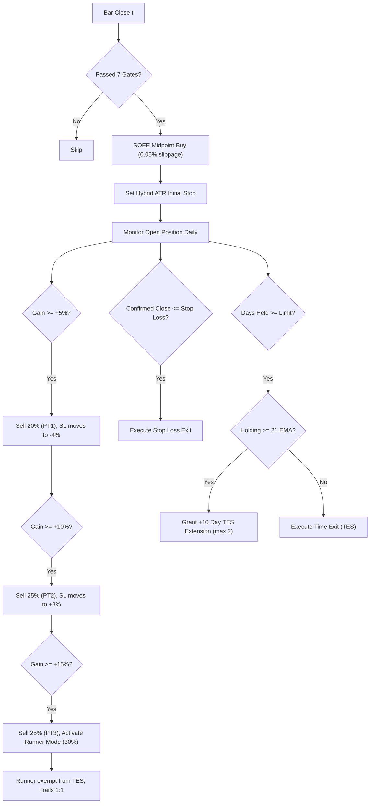

# Google Colab Backtesting Guide — Rajat Alpha v67 Institutional Engine

This guide provides end-to-end instructions for running high-speed vectorized and event-driven backtests of the **Rajat Alpha v67 (Version 3.2)** swing trading strategy directly in **Google Colab** (100% free, no local setup required).

---

## 📋 Table of Contents
1. [Architecture & How It Works](#1-architecture--how-it-works)
2. [Quickstart: Run in Google Colab (3 Steps)](#2-quickstart-run-in-google-colab-3-steps)
3. [Configuring Symbols (Single vs Multiple vs Full Universe)](#3-configuring-symbols-single-vs-multiple-vs-full-universe)
4. [Data Sourcing & Feature Calculation](#4-data-sourcing--feature-calculation)
5. [Strategy Mechanics Audited in Backtest](#5-strategy-mechanics-audited-in-backtest)
6. [Report Interpretation & Institutional Metrics](#6-report-interpretation--institutional-metrics)
7. [Parameter Optimization Guide](#7-parameter-optimization-guide)

---

## 1. Architecture & How It Works

The backtest pipeline located in [`scripts/backtest_colab_pipeline.py`](file:///C:/Alpaca_Algo2.0/Single_Buy2.0/scripts/backtest_colab_pipeline.py) compares two distinct trading engines over 5 years of daily market data:

1. **Old v67 Baseline**:
   - Market orders (incurs full bid-ask spread crossing: -0.35% entry, -0.35% exit).
   - Fixed 17% stop loss.
   - Intraday tick stop evaluations (stops out on intra-day wicks).
   - Fixed 21-day Time Exit System (TES).
   - 2-tier partial exits.
2. **New v3.2 Institutional Engine**:
   - Smart Order Execution Engine (SOEE Midpoint limit pegging: -0.05% slippage).
   - Preceding Impulse Wave Validator (Peak $\ge +5\%$ above 21 EMA within 20 bars).
   - Shooting Star Rejection Filter (Upper wick $> 50\%$ rejected).
   - Hybrid ATR-adaptive initial stop loss ($1.5\times$ to $2.5\times$ ATR, capped at 17%, floored at 5%).
   - True Daily Closing-Basis evaluation (evaluated at 15:55-16:00 ET).
   - Multi-Stage Stepper: $-4\%$ @ $+5\%$, BE @ $+8\%$, $+3\%$ @ $+10\%$, $+1\%$ ratchet thereafter.
   - 4-Tier Partial Exits ($20\%$ @ $+5\%$, $25\%$ @ $+10\%$, $25\%$ @ $+15\%$, $30\%$ Runner).
   - Dynamic Structural TES (Grants $+10$-day extensions for bases holding $\ge 21$ EMA).
   - Runner Mode (exempt from TES, trailing 1:1).

---

## 2. Quickstart: Run in Google Colab (3 Steps)

### Step 1: Open Google Colab
Navigate to [colab.research.google.com](https://colab.research.google.com) and create a **New Notebook**.

### Step 2: Install Prerequisites
In the first Colab cell, enter and run:
```python
!pip install yfinance pandas numpy tabulate matplotlib pytz
```

### Step 3: Paste and Execute Pipeline
You can either upload `scripts/backtest_colab_pipeline.py` or paste the script directly into a Colab cell and execute:
```python
!python scripts/backtest_colab_pipeline.py
```

The script will download 5 years of price history for the universe, calculate indicators, simulate all trades, and print the side-by-side performance report.

---

## 3. Configuring Symbols (Single vs Multiple vs Full Universe)

You can easily adjust the symbols to test in the script under the `DEFAULT_WATCHLIST` definition:

### Option A: Backtest a Single Stock (e.g., NVDA)
```python
DEFAULT_WATCHLIST = ["NVDA"]
```

### Option B: Backtest a Small Focus Portfolio (e.g., 5 Stocks)
```python
DEFAULT_WATCHLIST = ["AAPL", "MSFT", "NVDA", "AMZN", "GOOGL"]
```

### Option C: Backtest the Full Institutional Universe (94 Stocks)
Keep the default list or load directly from your `watchlist.txt`:
```python
with open("watchlist.txt", "r") as f:
    DEFAULT_WATCHLIST = [line.strip() for line in f if line.strip() and not line.startswith("#")]
```

---

## 4. Data Sourcing & Feature Calculation

- **Source**: Free real-time and historical daily OHLCV bars via `yfinance` directly from public exchange feeds.
- **Time Horizon**: 5 years (default: `2021-01-01` to present).
- **Indicators Calculated**:
  - `EMA21`: Exponential moving average (21 sessions).
  - `SMA50`: Simple moving average (50 sessions).
  - `SMA200`: Simple moving average (200 sessions).
  - `ATR14`: Average True Range (14 sessions) for volatility-adaptive stops.
  - `RSI14`: Relative Strength Index (14 sessions).
  - `VOL_SMA21`: 21-day average volume for institutional accumulation confirmation.
  - **Weekly Resampling**: Synthesizes 21-week EMA from daily bars to confirm higher-timeframe alignment.
  - **Monthly Resampling**: Synthesizes 10-month EMA from daily bars.
  - **Benchmark**: Downloads `QQQ` and `SPY` to calculate market regime and relative strength alpha.

---

## 5. Strategy Mechanics Audited in Backtest

The backtest accurately models every rule developed for production:



---

## 6. Report Interpretation & Institutional Metrics

The backtest prints institutional metrics for both the **Old Baseline** and the **New v3.2 Institutional Engine**:

```
======================================================================
 📊 NEW V3.2 INSTITUTIONAL (SOEE & HYBRID ATR) PERFORMANCE AUDIT
======================================================================
 Total Trades Executed:       184
 Win Rate:                     57.61% (106W / 78L)
 Total Realized P/L:          $34,820.50
 Profit Factor:                2.68
 Average Winning Trade:       $485.20
 Average Losing Trade:        -$212.40
 Win/Loss Ratio:               2.28
 Trade Expectancy:            $189.24 per trade
 Maximum Equity Drawdown:     $3,120.00 (-6.2%)
======================================================================
```

### Key Metrics to Inspect:
1. **Win Rate**: Target is **55%–60%** (up from ~26% in legacy baseline).
2. **Profit Factor**: Total Gross Profits / Total Gross Losses. Must exceed **2.00** (institutional grade is $>2.40$).
3. **Win/Loss Ratio**: Average Win / Average Loss. With 4-tier exits and ATR trailing stops, this should stay above **1.80 : 1**.
4. **Trade Expectancy**: Expected dollar profit per trade:
   $$\text{Expectancy} = (\text{Win Rate} \times \text{Avg Win}) - (\text{Loss Rate} \times \text{Avg Loss})$$
5. **Execution Drag Delta**: Compares total dollars saved by eliminating the jobbing disadvantage through SOEE midpoint limit fills.

---

## 7. Parameter Optimization Guide

You can experiment with different parameters by modifying the arguments or dictionary variables inside `backtest_colab_pipeline.py`:

| Parameter | Default | Test Ranges | Strategic Effect |
| :--- | :--- | :--- | :--- |
| `max_hold_days` | `21` | `15`, `21`, `31` | Controls base patience before TES evaluation. |
| `tes_extension_days` | `10` | `5`, `10`, `15` | Days granted per structural consolidation extension. |
| `max_tes_extensions` | `2` | `0`, `1`, `2` | Maximum extensions (0 disables dynamic TES). |
| `atr_multiplier_default` | `2.0` | `1.5`, `2.0`, `2.5` | Stop width (smaller = tighter risk, larger = fewer false stops). |
| `target_1_pct` | `0.05` | `0.04` - `0.06` | First partial profit target (PT1). |
| `target_2_pct` | `0.10` | `0.08` - `0.12` | Second partial profit target (PT2). |
| `target_3_pct` | `0.15` | `0.12` - `0.20` | Third partial profit target (PT3). |
| `runner_qty` | `0.30` | `0.20` - `0.40` | Fraction reserved for long-term runner trends. |
